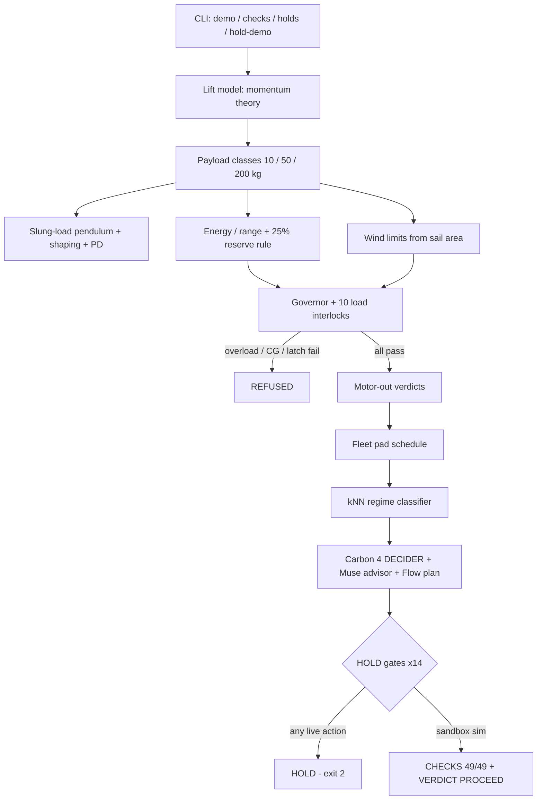
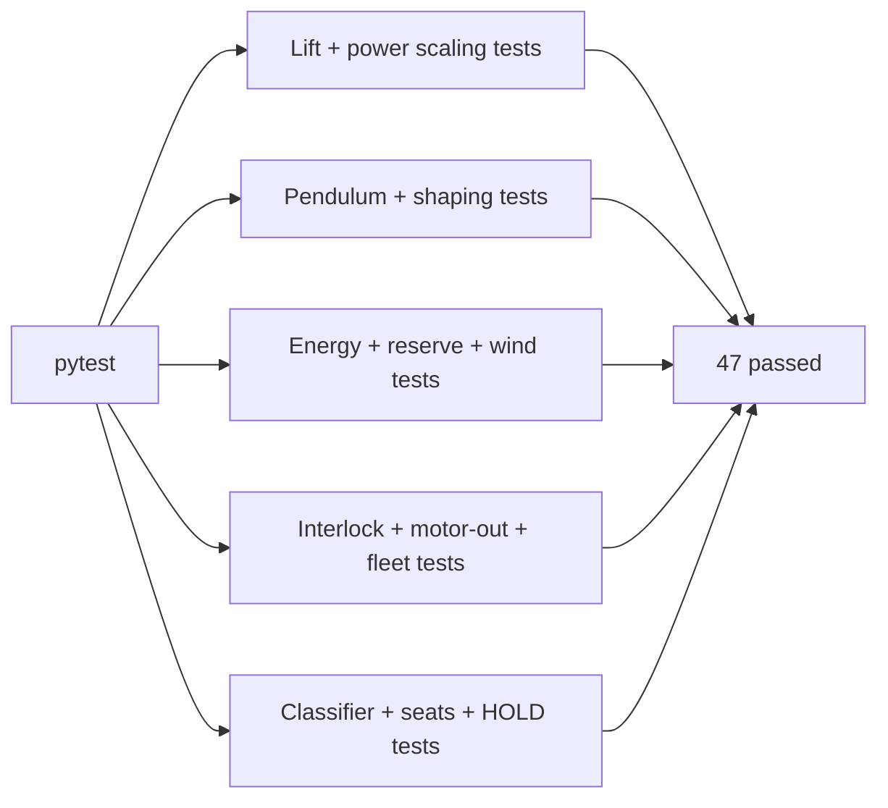
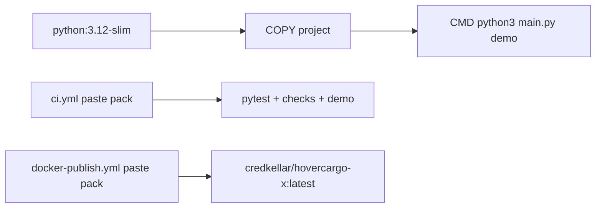

# 🚁 HoverCargo-X — Heavy-Lift Hover Cargo Transport Lab

> **A SIM-ONLY heavy-lift hover cargo lab in pure Python stdlib: a hexacopter freight vehicle modelled end to end — momentum-theory lift at cargo scale, slung-load pendulum physics with input-shaping + PD sway damping, a battery-vs-payload range table with a hard 25% reserve rule, wind limits from cargo sail area, 10 load interlocks that REFUSE overloads, motor-out verdicts per payload class, a 3-vehicle one-pad fleet schedule, and 14 HOLD gates. Nothing here lifts a real load.**
>
> 👨‍💻 By Darion Kellar · 📜 MIT License · 🐍 Pure stdlib · 🌐 Zero network


> ⚠️ The two workflow badges above are the live GitHub Actions badges for this repo. They switch on as soon as `ci.yml` and `docker-publish.yml` from the workflow paste pack are pasted into `.github/workflows/` (plural) — until then there are no workflow runs for them to report.

The X family flies three kinds of question. **HoverX** asked how a hover vehicle carries *people*; **DroneHover-Swarm** asked how *many small vehicles* fly together; **HoverCargo-X** asks the freight question: *what does it take to pick up 200 kg, carry it 38 km, and put it down gently — and what should refuse to fly?* The answers are real engineering math: hover power grows with weight to the 1.5 power and only falls with the square root of disk area (so cargo rotors are big and slow), a container on a cable is a pendulum that wind turns into a sail, and a hexacopter that loses a motor at max payload does not get to keep flying — it gets an honest LAND NOW. This lab computes all of that, asserts it in CHECKS, and keeps every live action behind 14 HOLD gates that nothing — including the AI seats — can lift.

---

## 🧰 Tech Stack Badges & Full Architecture Tech Stack

### 💻 Core Programming Languages & Core Systems


-brightgreen)


**🧠 Advisory seats (names-only, never override a HOLD):**


-34A853)

ONE `main.py` (933 lines) holds the lift model, pendulum sim, energy/range planner, wind limits, governor, interlocks, motor-out logic, fleet scheduler, classifier and seats — the whole vehicle can be read, run and audited in one sitting.

### ⛓️ Web3 & Infrastructure

None — honestly none. HoverCargo-X runs fully offline in one file; there is no chain, no token, and no wallet involved (and `investment_claim` is a HOLD gate).

### ⚙️ Platform Support & Hardware Architecture


Pure Python — it runs anywhere Python 3 runs (developed and verified on Linux). It talks to **no hardware at all**: no motors, ESCs, winches or latches are driven, ever — that is what the `real_hardware_control` HOLD gate means.

### ⚡ Low-Level Infrastructure & Performance


No compiled or low-level code — the honest performance story is the sim itself: fixed-step deterministic physics (pendulum integrated at 1 kHz, zero randomness anywhere) whose output is byte-identical on a double run, with every headline number asserted in CHECKS.

### 🛠️ DevOps & Build Tools


`ci.yml` (checkout → Python 3.12 → `pytest -q` → `python main.py checks` → `python main.py demo`) and `docker-publish.yml` (build + push `credkellar/hovercargo-x:latest`) are delivered in the workflow paste pack and are pasted into `.github/workflows/` by the repo owner, with that repo's own `DOCKERHUB_USERNAME` / `DOCKERHUB_TOKEN` secrets.

### ☁️ Cloud Providers

None — honestly none. There is no cloud call, no account, and no API key involved; the advisory seats are names-only seats in code, not live calls.

---

## What this does?

1. 🚁 **Builds the vehicle** — a 120 kg hexacopter (6 rotors, R = 0.90 m, 15.27 m² of disk, 30 kWh pack) and computes hover thrust = m·g for the 10 / 50 / 200 kg payload classes.
2. ⚡ **Prices the lift** — momentum theory: P = T^1.5 / √(2ρA) / FoM. Hover power comes out 9.9 / 14.8 / 38.3 kW by class, endurance 145 / 97 / 38 min.
3. 📐 **Proves the disk trade-off** — doubling thrust multiplies power by 2^1.5; quartering the disk area exactly doubles it. Big, slow rotors win, in arithmetic.
4. 🪢 **Hangs the load on a cable** — a 3 m sling is a 0.288 Hz pendulum; an unshaped accel pulse leaves 4.21° of residual swing.
5. 🎛️ **Damps the swing two ways** — ZV input shaping cuts the residual to 0.067°; PD sway feedback cuts max swing 13.80° → 10.03° and the residual to ~0. Rigid mount is compared honestly: no swing, but a straight a/g load factor and a CG shift.
6. 🔋 **Plans energy with a reserve rule** — range table by class (132.3 / 87.8 / 32.7 km one-way), and any leg that would land below 25% SoC is REFUSED, never planned.
7. 🗺️ **Audits a real hop** — Porter Ranch pad → LA warehouse district, 38 km at 50 kg: PLANNED, lands at 64% SoC, with the SoC drop reconciled against the audited energy.
8. 🌬️ **Sets wind limits from sail area** — the container is a sail; steady swing is capped at 10°, giving limits of 6.7 / 10.6 / 12.0 m/s by class (heavier loads resist wind better, until the vehicle cap binds), plus a GO / CAUTION / NO-GO verdict per forecast.
9. 🔒 **Runs 10 load interlocks** — measured weight, declaration match, CG inside its box, latch, pickup sway, battery, wind, motors, governor, spotter. A 240 kg load against a 200 kg limit is REFUSED, not warned.
10. 🛠️ **Recomputes motor-out honestly** — one motor out: 50 kg continues (margin ×3.60), 200 kg lands now (×1.91); two out at 200 kg is an emergency descent (×1.53).
11. 🅿️ **Schedules the fleet** — 3 vehicles share one pad in deterministic (ready-time, vehicle-id) order; slots are 6-minute turnarounds and provably never overlap.
12. 🧠 **Classifies and decides** — a stdlib kNN labels a mission go / caution / no-go; Carbon 4 decides (tighten-only, sha256 trace), Muse advises (can never override a HOLD), Flow storyboards plan-only — and CHECKS asserts every number above.

## 📊 Mermaid flowchart diagram per script

### `main.py` — the whole lab



### `tests/test_main.py` — verification



### `conftest.py` — test path setup


### `Dockerfile` + CI — container and pipeline



## Why is this cool?

1. 📦 It treats freight as a physics problem, not a drone with a box glued on — every cargo question gets a number.
2. ⚖️ The 1.5-power law is brutal and visible: 20× the payload costs ~4× the hover power, and the lab shows exactly why.
3. 🌀 Big rotors win in arithmetic, not opinion: quarter the disk and the power bill exactly doubles.
4. 🪢 Input shaping is genuinely magical to watch in numbers: the same move, split half a pendulum-period apart, leaves 0.067° of swing instead of 4.21°.
5. 🌬️ The wind result surprises everyone the first time: the *heaviest* load has the *highest* wind limit, because gravity is the restoring force.
6. 🔋 The reserve rule is a hard wall, not a suggestion — the planner would rather refuse a 200 kg / 120 km leg than land on fumes.
7. 🛠️ Motor-out verdicts are per-class and honest: the same failure is a shrug at 50 kg and an emergency at 200 kg.
8. 🔒 Overload is a REFUSAL with a reason list, the way real loadmasters think — not a yellow warning you can click through.
9. 🅿️ The one-pad fleet queue is a tiny, provable scheduler: deterministic order, fixed turnarounds, zero conflicts by construction.
10. 🎯 Deterministic end to end: run it twice, get byte-identical output — freight physics you can diff.

## What problems this solves?

1. ❌ **Problem:** "Heavy-lift drone" claims quote payload without the power bill. ✅ **Solution:** Momentum theory prices every class — 200 kg costs 38.3 kW just to hover.
2. ❌ **Problem:** Slung loads swing, and demos pretend they don't. ✅ **Solution:** The pendulum is simulated, and two independent cures (input shaping, PD feedback) are measured against the unshaped case.
3. ❌ **Problem:** Range figures ignore reserves. ✅ **Solution:** Every plan lands at or above 25% SoC or is REFUSED; the max-range table is built from the reserve backwards.
4. ❌ **Problem:** Wind limits get copied from the vehicle spec to every load. ✅ **Solution:** Limits are derived per class from sail area and a swing cap — light, sail-y loads ground first.
5. ❌ **Problem:** Overload checks are warnings in most sim tools. ✅ **Solution:** Ten interlocks, all must pass, and overweight / off-CG / unlatched are hard REFUSALS.
6. ❌ **Problem:** "Redundant motors" gets marketed as "can lose a motor, no problem." ✅ **Solution:** The margin is recomputed per class and the verdict degrades honestly: CONTINUE → LAND NOW → EMERGENCY DESCENT.
7. ❌ **Problem:** Multi-vehicle pads double-book in ad-hoc demos. ✅ **Solution:** A deterministic queue with fixed turnaround blocks; conflicts are impossible by construction and asserted in tests.
8. ❌ **Problem:** Cargo concepts quietly imply a delivery service exists. ✅ **Solution:** 14 HOLD gates — live flight, cargo ops, hazmat, commercial claims — all permanently held, exit code 2.
9. ❌ **Problem:** Physics code usually needs numpy / scipy installs. ✅ **Solution:** Pure standard library — runs anywhere Python 3.12 runs, zero pip installs for the lab itself.
10. ❌ **Problem:** Simulation tools hide their assumptions. ✅ **Solution:** Sim constants are labelled as sim values (FoM, sail areas, cruise fraction), and every headline number is asserted against an analytic value in CHECKS.

## How to install this?

1. 📥 Clone or download this project folder.
2. 🐍 Make sure Python 3.12+ is installed: `python3 --version`
3. ▶️ Run the full demo + checks (no arguments needed):

```bash
python3 main.py
```

4. 🧪 Run the test suite:

```bash
pip install pytest
python3 -m pytest -q
```

5. 🎛️ Try the other commands:

```bash
python3 main.py checks     # 49 built-in checks
python3 main.py holds      # list all 14 HOLD gates
python3 main.py hold-demo  # exits 2 — gated actions stay HOLD
```

6. 🐳 Or run it in Docker:

```bash
docker build -t credkellar/hovercargo-x:latest .
docker run --rm credkellar/hovercargo-x:latest
```

## Requirements

- 🐍 Python 3.12 or newer
- 📦 Dependencies: **none** (standard library only)
- 🌐 Network: **none** — fully offline
- 🧪 For tests only: `pytest`
- 🐳 Optional: Docker

## FULL project structure tree

```text
hovercargo-x/
├── main.py                  # the whole lab: lift, pendulum, energy, wind, interlocks, motor-out, fleet, classifier, seats, HOLD gates
├── conftest.py              # puts the project root on sys.path for tests
├── tests/
│   └── test_main.py         # 47 pytest tests: lift, pendulum, energy, wind, interlocks, motor-out, fleet, seats, gates
├── assets/
│   └── cover.png            # README cover image (2736 x 912)
├── Dockerfile               # python:3.12-slim, runs the demo
├── .gitignore               # __pycache__, .pytest_cache
└── README.md                # this file
```

> 📦 Delivered separately as paste packs (not in this tree): `.github/workflows/ci.yml` + `docker-publish.yml`, and the Docker Hub pack (100-char description, 350-char About, overview, categories).

## 🛑 The HOLD list — 14 gates

| Gate | What stays held |
|---|---|
| `live_flight` | No real flight — simulation only. |
| `cargo_ops_live` | No real cargo is picked up, carried, or dropped. |
| `real_hardware_control` | No motors, ESCs, winches, or latches are driven. |
| `bypass_governor` | Governor caps cannot be bypassed. |
| `disable_load_interlocks` | Load interlocks cannot be disabled or skipped. |
| `fly_over_people_live` | No live flight over people or property. |
| `hazmat_cargo_live` | No hazardous cargo is ever carried live. |
| `claim_certified` | Never claim this sim is a certified cargo aircraft. |
| `commercial_service_claim` | No delivery service is offered or implied. |
| `remove_human_override` | Human override is never removed. |
| `bvlos_live` | No live beyond-visual-line-of-sight operation. |
| `exceed_payload_live` | The payload limit cannot be exceeded live. |
| `medical_delivery_claim` | No medical delivery capability is claimed. |
| `investment_claim` | No investment or revenue claim is made. |

**Advisory seats:** Gemini Carbon 4 DECIDER (MAP → MODEL → STRESS → DECIDE, tighten-only, sha256 trace) · Muse advisor (`can_override_hold=False`) · Google Flow plan-only (`rendered=False`, `live=0`).

**Verification:** pytest 47 passed · CHECKS 49/49 · double-run byte-identical · hold-demo exits 2.

## 🧒 In plain English (5th grade)

Imagine a really strong helicopter with six spinning fans, built to carry heavy boxes through the air. 🚁

- Spinning fans push air down, and that push lifts the helicopter. The heavier the box, the harder the fans must push — and heavy boxes need *way* more push, not just a little more. That is why the fans are big and wide: big fans are cheaper to run. ⚡
- If the box hangs from a rope, it swings like a swing at the playground. This lab teaches the helicopter two tricks to stop the swinging: move in two small steps timed just right, or lean gently against the swing until it calms down. 🪢
- Wind pushes the hanging box like a sail on a boat. Skinny light boxes get pushed around easily, so they must stay home on windy days. Heavy boxes actually handle wind better! 🌬️
- Before flying, the helicopter checks ten things: Is the box too heavy? Is it hooked on tight? Is it balanced? Is the battery full? If anything is wrong, it says **NO** — and it means it. 🔒
- If one fan breaks, the helicopter does the math again. With a light box it can keep going. With the heaviest box it must land right away. It never pretends everything is fine. 🛠️
- This is all pretend, on a computer. No real helicopter flies and no real box is lifted. It is a learning lab that shows the real math of carrying heavy things through the air. 💻

---

MIT © 2026 Darion Kellar · HoverCargo-X — educational simulation only 🚁
